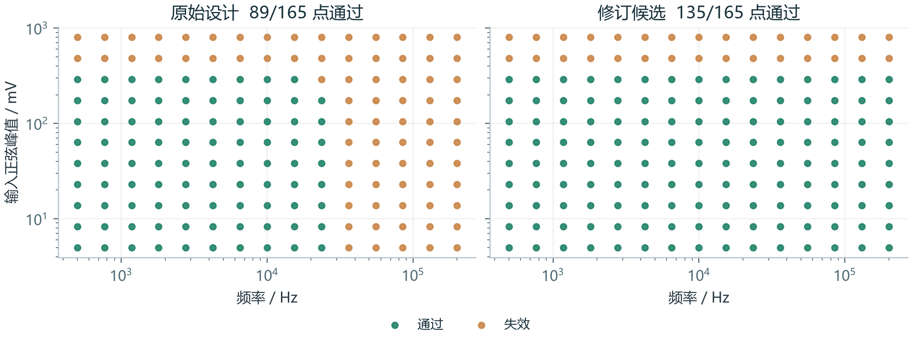

# 芯界 BoundaryLab



> 当前版本支持放大器与有源低通两种参数化拓扑，使用通用行为运放模型。实际效果以随附仿真和评测记录为准。

面向电路专业学习与科研的自主实验智能体。给定电路和性能目标，Agent 登记假设、选择实验、调用真实 ngspice 仿真，寻找失效边界，再提出参数修改并独立复测。

## 快速体验

**Windows：双击 `启动芯界.cmd`，浏览器会自动打开可用入口（优先使用8765，端口占用时自动避让）。**

首次运行需要 Python 3.12 或更新版本与网络，用于在本目录创建 `.venv` 并安装 Python 依赖。作品已附 Windows 版 ngspice，无需安装商业 EDA。已在 Windows x64、Python 3.12.14、ngspice 47 环境验证。

也可手动启动：

```powershell
python -m venv .venv
.\.venv\Scripts\python.exe -m pip install -r requirements.txt
.\.venv\Scripts\python.exe -m lab.cli serve --port 8765
```

macOS / Linux：安装本平台 ngspice，并使用 Python 虚拟环境安装相同依赖；必要时通过 `NGSPICE_PATH` 指定执行文件。其他平台尚未实机验证。

## 三种体验方式

1. **检查真实历史研究**：首页默认载入精选记录。点击地图点、查看波形、展开事先预测、切换候选设计、查看网表与研究报告。不需要 API 即可检查记录。
2. **本地策略**：选择“本地策略 · 非大模型”并启动，可实际重跑工具流程。界面明确标注为数值策略，不能视为大模型 Agent 结果。
3. **在线 Agent**：将 `.env.example` 复制为 `.env`，在本地配置 DeepSeek 密钥，再选择 DeepSeek 模式。密钥只从服务端配置读取，公开包不含密钥。在线调用有实际费用。

配置例子：

```dotenv
DEEPSEEK_API_KEY=在本地填写
DEEPSEEK_BASE_URL=https://api.deepseek.com
DEEPSEEK_MODEL=deepseek-flash
```

服务只绑定本机127.0.0.1。Windows启动入口会优先复用已运行的芯界服务；否则选择可用端口，并在服务就绪后打开浏览器。手动使用CLI指定端口时，仍需确保对应端口空闲。

## 研究流程

选择精密放大器或有源低通滤波器，填写研究问题，检查输入频率、输入正弦峰值、增益误差和残差失真阈值。启动后，模型通过原生工具调用提交实验，工具检查参数、执行仿真并返回测量。

默认 Agent 搜索预算为10次，包含标称基线。独立地图每个设计165个对数网格点，另计验证预算。Agent 最多提出两轮设计参数候选，第二轮只在独立验证仍发现特定范围内的残余失效时触发。所有候选保持目标增益、摆幅和验收合同。

每个实验计划先于结果写入日志。事先通过/失败预测不符时，界面标记“事先预测被实验反驳”。模型可能做出错误判断；冻结的工具验收不会随解释改变。

## 已完成的实际演示

精选研究为 `20261025-120344-635c24`，使用 DeepSeek 原生工具调用与 ngspice 47：

- 10次搜索实验，发现6个不符合合同的点。
- 9次模型事先预测中，2次被实际测量反驳。
- 原始独立网格通过89/165点。
- 首轮候选通过134/165点；将残余失效返回模型后，修订候选通过135/165点。
- 候选仍保留输出摆幅约束造成的失败，未宣称全域正确。

全部数值限于通用行为模型与本次离散采样。候选的功耗、成本、真实器件实现与工艺角未验证。

## 冻结评测

`artifacts/benchmark/experiment_contract.json` 为运行前冻结的8任务评测合同；`results.json` 和 `评测报告.md` 保存全部结果。每任务最多8次搜索仿真；随机搜索3个种子，其余方法每任务1次。

在6个含失效的预设任务上，Agent、固定测试、本地策略都找到了6/6个任务的反例，随机搜索找到14/18次。两个正常预设任务各方法均未报告失效。本评测不支持“全面超越固定测试”或统计显著性声明；机制审查数量也不能冒充独立人工诊断准确率。

```powershell
.\.venv\Scripts\python.exe -m pip install -r requirements-dev.txt
$env:PYTHONPATH=(Get-Location).Path
.\.venv\Scripts\python.exe scripts/benchmark.py
# 在线评测会实际调用 API；按需添加 --include-model
.\.venv\Scripts\python.exe -m pytest -q
```

## 重跑与证据导出

界面“导出证据包”包含合同、模型工具调用记录、事件日志、网表、原始瞬态数据、测量结果、报告和逐文件 SHA-256。哈希用于检查内部一致性，不提供外部时间戳或不可篡改保证。

重跑精选搜索实验：

```powershell
.\.venv\Scripts\python.exe -m lab.cli replay artifacts/studies/20261025-120344-635c24/study.json
```

加 `--all` 可重跑证据所引用的全部原始与候选地图点。离线重跑不调用模型；它验证保存的实验与数值，而不是重新生成相同的模型决策。

命令行发起新研究：

```powershell
.\.venv\Scripts\python.exe -m lab.cli run --mode local --budget 10
.\.venv\Scripts\python.exe -m lab.cli run --mode deepseek --budget 10
```

## 模型与测量定义

`lab/engine.py` 实现公开的通用非理想运放模型：有限 A0、单主极点、限流积分器确定 SR、摆幅限幅与抗积分饱和。低通案例额外加入输入 RC。不使用厂商标称来冒充真实器件。

瞬态仿真14周期，最后4周期统一采样，以正弦/余弦最小二乘拟合基波。残差失真 = 移除直流与基波后的残差 RMS / 基波 RMS，包含数值误差。增益误差相对于各拓扑的理想响应；低通的预期滚降不当作失效。测试包括独立主极点公式对照与加密时间步长复核。

机制分为“观测支持”“对照支持”“证据不足”，不把特征规则称为唯一因果证明。地图是离散测量点，不是连续范围证明或器件良率。

## 目录

```text
lab/                 仿真、Agent、审查、导出与本地服务
web/                 中文工作台，完全本地静态资源
scripts/             评测、浏览器检查与材料生成脚本
tests/               物理、接口、证据完整性检查
vendor/Spice64/      原版 ngspice Windows 发行文件与许可
artifacts/studies/   真实研究记录与模型工具调用轨迹
artifacts/runs/      记录所引用的原始仿真数据
artifacts/benchmark/ 冻结评测合同与结果
docs/                参赛说明与演示资料
```

原始代码采用 MIT；第三方工具保留各自许可，见 `THIRD_PARTY_NOTICES.md`。实际参赛身份资料由参赛者在学校问卷填写。
